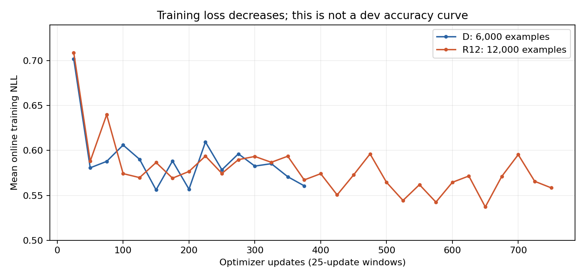

# D・R12：公開dev診断と本番回答の統合分析（2026-10-21）

## 結論

**条件Dの本番スコアは0.16999。R12は0.12394で、Dから−0.04605。Dも既知の最高run03の0.18758を超えなかった。** D/R12の提出metadata上の推論設定と主要ライブラリ版は一致している。今回、推論環境差を悪化の主説明にはしない。

Dの時点で長文・反復・正答後の矛盾が増え、R12ではAMPSとmath_compでさらに悪化している。Dで正しかった演算をR12が誤る例もある。一方、改善例もあり、全体の能力が一様に低下したわけではない。

保存済みdevでは27問改善・32問悪化で差は5問。95%区間が0を跨ぎ、これだけで確定的な正答率低下とは言えない。しかし本番スコアと実回答の検算は、今回のrank64・12,000件への変更を採用する根拠になっていない。提出基準はrun03を維持する。

**学習lossは低下している。EOSも全例に付いている。したがって、「学習が発散した」「EOSが抜けた」「教師文が倍に長くなった」という単純な説明は、得られた資料では支持されない。** lossが改善しても、生成時の数学的整合性・終了挙動は改善していない。

## 入力・範囲・検証

- 受領archive：`rank64_12k_20261021_183439_saved_v1.tar.gz`。公開devの正誤・生成統計、教師token、Dの375更新とR12の750更新のログ、checkpoint一覧を解析。
- D：`submission_rank64_D.json`、run ID `rank_20261021_165303_D`。Stage 1 run01、fresh rank64/alpha128、PRM4,500＋GSM1,500、375更新。
- R12：`submission_rank64_12k.json`、run ID `rank64_12k_20261021_183439`。Stage 1 run01、fresh rank64/alpha128、PRM9,000＋GSM3,000、750更新。**Dのadapterを継続学習したモデルではない。**
- 本番の比較先：未編集run03。D/R12を含む232個のID集合とprompt token数が一致。
- Dの公式形式チェック：error 0、warning 0、violation 0。形式検査は正解検査ではない。
- D/R12の推論設定：context8,192、全task上限2,048、FP16、temperature0、seed42、chunk32、n=1、GPU memory0.8。記録されたvLLM・torch・transformers版も一致。
- 本番スコアはユーザー報告。公式の問題別採点結果は未入手。提出ファイルは回答本文だけを検査し、問題ファイル・正解データ・規則DOCXは今回読んでいない。回答が元問題を正確に写しているかは未検証。
- archiveに公開devの回答本文は含まれないため、その32件/27件の数学的な誤答理由は特定していない。分野・長さ・反復・終了・unknownフラグまでは比較できる。
- 入力ファイルは無変更。新規学習・モデル推論・再採点・提出送信は行っていない。個別の本番例を教材選択・学習に転用しない。

## 1. dev400：D→R12の変化

| 指標 | D | R12 |
|---|---:|---:|
| 正答数 / 400 | 253 | 248 |
| 正答率 | 63.25% | 62.00% |
| GSM / 100 | 86 | 85 |
| PRM / 300 | 167 | 163 |
| 反復 | 249（62.25%） | 257（64.25%） |
| non_stop | 259（64.75%） | 273（68.25%） |
| unknown | 23 | 27 |
| 平均生成token | 1,389.72 | 1,451.76 |

正解維持221、誤答維持120、誤答→正解27、正解→誤答32。**59/400問（14.75%）の正誤が入れ替わり、差し引き5問減った。** 差が小さいことは出力がほぼ不変という意味ではない。

R12−Dのpaired bootstrap 95%区間は **−5.25〜＋2.50ポイント**、観測差は−1.25ポイント。区間は問題の再標本化だけで、学習・推論の実行間変動は含まない。分野別は多重比較補正のない探索的分析。

### 分野別

| 分野 | n | D正答 | R12正答 | 誤→正 | 正→誤 | 差（問） |
|---|---:|---:|---:|---:|---:|---:|
| Algebra | 72 | 56 | 53 | 3 | 6 | -3 |
| Geometry | 34 | 17 | 17 | 1 | 1 | +0 |
| Prealgebra | 42 | 30 | 32 | 2 | 0 | +2 |
| Intermediate Algebra | 54 | 19 | 17 | 5 | 7 | -2 |
| Number Theory | 35 | 17 | 17 | 3 | 3 | +0 |
| Precalculus | 35 | 14 | 15 | 5 | 4 | +1 |
| Counting & Probability | 28 | 14 | 12 | 0 | 2 | -2 |
| arithmetic | 100 | 86 | 85 | 8 | 9 | -1 |

Algebra−3、Intermediate Algebra−2、Counting & Probability−2、GSMのarithmetic−1を、Prealgebra＋2、Precalculus＋1が一部相殺した。特定分野への一様な改善ではない。Counting & Probabilityの0改善・2悪化も28問だけの観測で、一般化しない。全分野の信頼区間は[集計JSON](20261021_d_r12_diagnostic_metrics.json)に保存。

問題文の長さ別では、250文字以下293問で19改善・27悪化（−8問）、251〜750文字103問で8改善・5悪化（＋3問）、750文字超4問で変化なし。長い問題だけが悪化したわけではない。ただし分野構成などの交絡があり、長さの因果効果ではない。

### 悪化32問の挙動

- 平均生成長：1,287.59→1,692.19 token（＋404.59）。
- 反復とnon_stopはいずれも19→26件。
- **7件**はDの正常終了・非反復からR12の非stop・反復へ変化。
- **19件**はDもR12も非stop・反復していたが、正答から誤答へ変化。
- **6件**は両方正常終了・非反復で、正答から誤答へ変化。
- R12でunknownになったのは5件。unknownは抽出失敗・grader error等のまとめで、このarchiveでは内訳が分からない。

したがって、新たな反復の発生だけでは32件の悪化を説明できない。対して改善27問の平均長は1,363.00→1,346.41とほぼ不変で、non_stopも17→17。Dでunknownだった4件がR12で正答になった。正答維持221問でもR12の127件が非stopなので、非stopを誤答と同一視しない。

59件のID・科目・長さ・終了・unknownの全一覧は[個別変化表](20261021_d_r12_dev_changes.md)。正誤変化の内容そのものを掘る場合は、将来、保存済みの公開dev回答を参照すればよく、再推論は不要。

## 2. checkpointと学習loss

受領した一覧で、実際に残っているcheckpointは **725・750のみ**。125・250・375・500は欠落している。750は既存dev結果を再利用できる。725は存在するが未評価であり、今回は低優先の再推論を実行しなかった。

削除済み重みはlossログから復元できないので、**375更新以前の正答率・生成長がいつ悪化したかは今回確定できない**。以下のloss曲線を正答率曲線の代わりにしない。

| 学習ログ指標 | D | R12 |
|---|---:|---:|
| 完了更新数 | 375 | 750 |
| 平均loss（更新平均） | 0.59012 | 0.57946 |
| 最初の25更新 | 0.70180 | 0.70895 |
| 最後の25更新 | 0.56065 | 0.55843 |
| 最初の125更新 | 0.61333 | 0.61619 |
| 最後の125更新 | 0.57914 | 0.56556 |
| loss範囲 | 0.40263〜1.00732 | 0.34920〜1.00589 |
| clipping前gradient norm最大 | 1.62785 | 2.89536 |
| norm>1の更新 | 13/375 | 19/750 |
| 更新処理の合計時間 | 743.39秒（12.39分） | 1,496.37秒（24.94分） |

更新番号は連続し、保存されたloss・gradient norm等はすべて有限値だった。**完了した更新の記録に数値発散の証拠はない。** AMP retryの有無は、この集計に含まれないconsoleログを見ないと判断できない。

R12の追加375更新もlossはおおむね0.54〜0.60の範囲で、最終値はDと同程度。教師文の予測が上手くなることと、本番の数学的正答率が上がることが乖離している。ただし各更新は異なるbatch・異なる時点のモデルなので、loss差を同一検証データ上の汎化性能差とは解釈しない。

batch平均長とlossの単純Pearson相関はD −0.394、R12 −0.418。少なくとも長いbatchほどlossが高いという関係ではない。ただし内容、学習時点、datasetが混ざった相関であり、長文模倣の因果効果を示さない。部分別の実測NLLは未保存なので、この相関から「説明がlossを薄めた」とも断定できない。

### 25更新窓の全記録（更新平均loss）

| 更新範囲 | D | R12 |
|---|---:|---:|
| 1〜25 | 0.70180 | 0.70895 |
| 26〜50 | 0.58072 | 0.58804 |
| 51〜75 | 0.58788 | 0.63989 |
| 76〜100 | 0.60606 | 0.57424 |
| 101〜125 | 0.59018 | 0.56982 |
| 126〜150 | 0.55615 | 0.58662 |
| 151〜175 | 0.58831 | 0.56920 |
| 176〜200 | 0.55688 | 0.57667 |
| 201〜225 | 0.60952 | 0.59380 |
| 226〜250 | 0.57853 | 0.57446 |
| 251〜275 | 0.59627 | 0.58982 |
| 276〜300 | 0.58264 | 0.59338 |
| 301〜325 | 0.58534 | 0.58685 |
| 326〜350 | 0.57080 | 0.59364 |
| 351〜375 | 0.56065 | 0.56723 |
| 376〜400 | — | 0.57417 |
| 401〜425 | — | 0.55054 |
| 426〜450 | — | 0.57283 |
| 451〜475 | — | 0.59620 |
| 476〜500 | — | 0.56452 |
| 501〜525 | — | 0.54436 |
| 526〜550 | — | 0.56196 |
| 551〜575 | — | 0.54249 |
| 576〜600 | — | 0.56457 |
| 601〜625 | — | 0.57160 |
| 626〜650 | — | 0.53713 |
| 651〜675 | — | 0.57116 |
| 676〜700 | — | 0.59539 |
| 701〜725 | — | 0.56569 |
| 726〜750 | — | 0.55843 |

## 3. 教師tokenと学習信号

受領したリモート集計は、前回のローカル公開教材キャッシュ集計と一致した。共通6,000例のtoken列も同一。**token数・loss対象の配分は確認できたが、部分別lossや勾配の大きさは測れていない。**

| 項目 | D | R12 |
|---|---:|---:|
| 例数 | 6,000 | 12,000 |
| 平均系列長 | 266.43 | 269.62 |
| 中央値 | 197 | 197 |
| p90 / p99 | 513 / 1,082 | 534 / 1,094 |
| 最長 | 1,923 | 1,974 |
| 教師target総数 | 1,592,551 | 3,223,460 |
| 問題文割合 | 25.532% | 25.822% |
| 最終boxedより前の説明 | 64.577% | 64.368% |
| 最終boxed | 2.398% | 2.379% |
| boxed後の本文 | 3.290% | 3.276% |
| EOS | 0.377% | 0.372% |
| 書式＋領域境界 | 3.827% | 3.782% |

最初の予測不能tokenを除く全targetを集計した。最終boxedは機械的な区間で、回答内容の正しさや解説全体の意味を分類したものではない。boxed後の3.3%には単位・説明等があり得るため、全部を不要な文章や反復の原因とは扱わない。

学習は固定16例のtarget総数で各更新を正規化する。更新ごとの割合を等重みで平均すると、最終boxedはD 2.462% / R12 2.452%、EOSはD 0.390% / R12 0.386%。全体token割合と少し異なるが、両条件の配分がほぼ同じという結論は変わらない。

全例に最終boxedがあり、EOSも1個ずつ末尾にある。EOS以後のtokenは0。EOSが少数targetであることは確認できるが、EOSは予測しやすさも異なるため、**0.37%だから終了が学べないとは言えない**。モデルが生成中にEOSへ至る状態に入れない可能性などは、今回の集計では区別できない。

R12の追加6,000例の平均長は272.82で、元の6,000例の266.43から大きな増加はない。教師長がほぼ同じなのに生成長は増えており、単なる教材長のコピーだけでは説明が足りない。

### R12途中の実際の学習量

| 更新 | 消費例数 | 元D教材 | 追加教材 | 累積target |
|---|---:|---:|---:|---:|
| 125 | 2,000 | 1,001 | 999 | 540,221 |
| 250 | 4,000 | 2,006 | 1,994 | 1,074,733 |
| 375 | 6,000 | 3,009 | 2,991 | 1,605,454 |
| 500 | 8,000 | 4,021 | 3,979 | 2,142,619 |
| 750 | 12,000 | 6,000 | 6,000 | 3,223,460 |

375更新時点は6,000例を消費したが、元D教材は3,009例だけ。Dの全6,000例を学習した状態とは異なる。schedulerもDは総375更新・warmup12、R12は総750更新・warmup23なので、同じ375更新地点でもLRの進行は異なる。教材追加、更新量、更新順・LR履歴をこの比較から分離できない。

## 4. Dの本番提出回答：run03・R12との比較

| モデル | 本番スコア | 平均token | 中央値 | 上限到達 / 232 | 反復 / 232 |
|---|---:|---:|---:|---:|---:|
| run03（rank8・6,000件） | **0.18758** | 789.37 | 358 | 56（24.14%） | 55（23.71%） |
| D（rank64・6,000件） | **0.16999** | 1,366.67 | 2,048 | 131（56.47%） | 121（52.16%） |
| R12（rank64・12,000件） | **0.12394** | 1,573.81 | 2,048 | 156（67.24%） | 145（62.50%） |

Dはrun03からスコア−0.01759、R12はDから−0.04605。これらは本番スコアの差で、正答率ポイント差ではない。Dの学習は約12.4分でも、生成時には長文・反復が増えている。

反復は同じ空白区切り10語が4回以上出る基準。上限到達はtoken数による判定で、提出JSONにfinish reasonはないため公式なlength終了率ではない。run03→Dで新規反復81件・解消15件、D→R12で新規反復40件・解消16件。全文一致は各比較15件だが、文章の変化数を正誤変化数とは扱わない。

| task | n | run03反復 / 上限 | D反復 / 上限 | R12反復 / 上限 | 平均token D→R12 |
|---|---:|---:|---:|---:|---:|
| AMPS_Hard | 100 | 12 / 11 | 35 / 34 | 48 / 49 | 916.29→1,194.17 |
| math_comp | 96 | 30 / 32 | 70 / 77 | 87 / 93 | 1,720.77→2,012.70 |
| olympiad | 36 | 13 / 13 | 16 / 20 | 10 / 14 | 1,673.47→1,457.97 |

AMPSとmath_compではDの時点で悪化傾向があり、R12でさらに増える。一方olympiadはD→R12で反復・上限到達が減るため、全taskが同じ方向に変わったわけではない。公式task別得点がないので、全体スコア低下を各taskへ配分することはできない。run03とはolympiad上限等が違うが、D/R12間は同じ設定である。

### 数学的内容の具体例

以下は**回答中に書かれた演算の検算**。元問題・公式正解との照合ではなく、公式の問題別正誤を再現したものではない。indexは過去の未編集回答配列の0始まり、照合はIDで実施。

| index / ID先頭 | run03 | D | R12 | 解釈 |
|---|---|---|---|---|
| 76 / `cebece7f5ebd` | 最大公約数247 | 247 | 1 | 回答中の整数では247が正しい。D→R12で計算が悪化。Dも「任意の部分集合と最大公約数が同じ」という誤った一般論を反復する。 |
| 77 / `c71563a982aa` | 最大公約数4 | 1 | 1 | 1が正しく、Dで改善。ただしDは後から「256は196と225の倍数」と誤った説明を足し、上限まで反復。 |
| 83 / `9de987b7e273` | 最大公約数924 | 12 | 12 | 924が正しい。Dの時点で引き算を誤り、R12でも直っていない。 |
| 195 / `2c8d111408d8` | 正しい係数付き因数分解 | 同じく正しい、117 token | 最終boxedで係数5を落とす、178 token | D→R12の悪化。反復や長さ上限がなくても最終化に失敗する。 |
| 210 / `76513dc871c4` | 正しい微分 | 最終式の符号が逆、78 token | 正しい符号、2,048 token | R12で計算は改善。ただし説明を反復。run03は既に正しく短かった。 |
| 229 / `a430c98bb36d` | 行列式−5、82 token | −5の後「行列式0なので特異」と反復 | 同じ矛盾を反復 | D/R12とも答えは合っていても説明が自己矛盾。両方2,048 token。 |

例76・83はPythonの整数最大公約数で検証、例195は展開して元の回答内の多項式と比較、例210は微分、例229は回答中の行列式計算を検証した。

### fix7の7件はDでも解決していない

D/R12とも以下7件に数学的誤りが残る。この7件は選択済みの非ランダム標本で、全体成績の推定には使わない。

| index | Dの誤り | 検算・R12との関係 |
|---|---|---|
| 38 | 積を負の−510,306とする | 回答中の積は正の500,094。R12も同じ符号・計算ミス。 |
| 40 | 正数の4乗根から負数の6乗根を含む式へ飛ぶ | 正しくは28√30。Dは負数の主6乗根を実数とする誤説明も追加。R12も未修正。 |
| 47 | 平均を1/6とし、標準偏差も誤る | 正しい平均7/6、標本分散9,329/30。DとR12の最終式は違うが両方誤り。 |
| 207 | 正しい微分途中から、因数分解でxを落とす | Dの指数関数項は20x³になり、必要な20x⁴と違う。R12は200x³となる。 |
| 213 | 不定積分の符号が逆 | 正しくは+cos(1−7x)+C。D/R12とも負符号。 |
| 226 | 行列式0とする | 回答内の行列の行列式は−530。Dは行/列が同じという事実でない説明も反復する。 |
| 227 | −13/50−1443/100を−1479/100とする | 正しくは−1469/100。D/R12とも未修正。Dは負の行列式を非可逆の根拠にする誤説明も加える。 |

Dの47・207・213は317・289・58 tokenで終わるため、終了挙動の修正だけでは7件は解決しない。DとR12で一部の最終式が変わっても、必ずしも正しい方向への変更ではない。

## 5. 仮説ごとの判定

| 仮説 | 今回の評価 | 根拠と限界 |
|---|---|---|
| 1. rank64で長文・反復を強めた | **観測は整合的、rank単独の因果効果は未確定** | 6,000件のDで既にrun03より長文・反復が多く、本番スコアも低い。Aは旧学習実装の既存モデルなので、rank以外の実装・数値計算差や実行変動を完全には分離できない。 |
| 2. 全文NLLが不要な続きを同時に学ばせる | **候補として残るが直接証明なし** | 約26%が問題文、約64%が最終boxedより前、最終boxed約2.4%。ただしD/R12で配分は同じで、EOSも正常。部分別NLL・勾配、生成のどこで逸脱するかは未測定。 |
| 3. rank64＋学習量増加で能力が変化 | **今回の変更全体としての悪化を支持** | 同じ提出推論設定でD 0.16999→R12 0.12394。Dの正しい演算が崩れる例も確認。ただし追加教材・更新数・LR履歴は未分離で、Dからの継続学習でもない。 |
| 4. dev400が本番を十分に代表しない | **懸念を支持** | dev差は−1.25ポイントで区間が広い一方、本番差は−0.04605。公開devはPRM/GSM、本番はAMPS/math_comp/olympiadを含み、採点方法も同一と確認できていない。尺度の違いがあるため差の大きさを直接換算しない。 |

本番の反復・上限到達だけを採用基準に置き換えるべきでもない。正しい数値の後に反復する例、短く誤る例、olympiadで反復が減っても全体スコアが下がる例がある。主指標は正答率・本番スコアを維持し、終了指標を併記する。

## 6. 今回はここまでで判断できること・残ること

- **採用判断**：今回のD/R12はrun03を超えず、12,000件への増量を続ける根拠は得られなかった。
- **新規学習なしで次に可能**：保存済み公開devの59件の回答本文を読み、計算ミス・最終回答抽出・反復後の答え変更を分類する。今回のarchiveは本文を含まないため、本文レベルの原因分類は未実施。
- **低優先の追加計算**：725 checkpointのdev評価、保存済みモデルの固定公開probeに対する領域別NLL。いずれも今回は行っていない。725だけでは早期の劣化開始時点は分からない。
- **復元できない点**：125〜500の正答率曲線、当時の領域別loss・gradient。再学習で作り直すことは今回の目的・優先順位に含めない。
- **今後もし新規学習をする場合の計測改善**：全checkpoint保持ではなく、指定した少数地点のadapterだけを保持し、固定の公開probeで最終式整合性・EOSのNLLを別々に記録する。ただし今回は学習コード・条件を変更していない。

入力hash・全分野CI・生成統計・token配分・loss要約は[集計JSON](20261021_d_r12_diagnostic_metrics.json)。元archiveはDownloads、展開物はgit管理外の `local_eval/rank64_diagnostics_received/`、作業集計は `local_eval/rank64_diagnostics_review/`。原本のモデル・回答・checkpointは変更していない。
